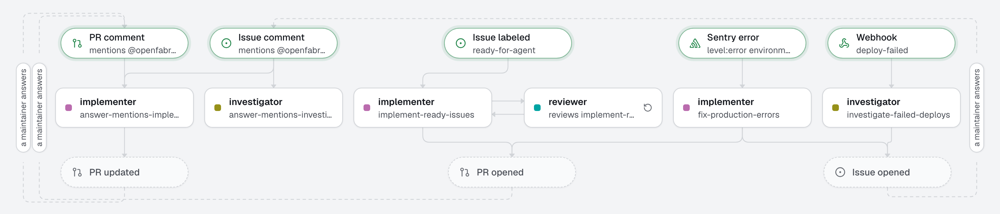

# 00: At a glance

The whole format in a handful of files: three agents, three automations, one shared skill, an integration, a webhook and an MCP server. A maintainer labels an issue and gets a pull request, read by a reviewer before it opens; a new production error becomes a fix on its own; a failed deploy becomes an investigated issue. A human merges.

Start here to see what a factory is. Start from [01-quickstart](../01-quickstart) to set up your first one, and read [02-sdlc](../02-sdlc) for a full engineering flow with triage and review.

## What this factory does



Every pull request has passed `pnpm test` and `pnpm lint`, run by the engine before it leaves the machine. On a labeled issue, `reviewed_by: reviewer` has the reviewer read the change first: it sends it back to the implementer until it approves, then the pull request opens with `ready-to-merge` and its risk, or with `needs-human` when the rounds run out. The implementer and the investigator read up-to-date library documentation through the `docs` MCP server ([Context7](https://context7.com)), with two read-only tools.

Least privilege: the investigator and the reviewer have no `edit` tool; the investigator may only open issues, and the reviewer writes nothing on GitHub, it only gives a verdict. The implementer may open pull requests and issues, comment, and remove `ready-for-agent` from an issue too vague to act on, but neither add labels nor push to an existing pull request.

## Tree

```
openfabriq/
├── factory.yaml                               checks, Sentry, the deploy-failed webhook, the docs MCP server
├── agents/
│   ├── implementer/
│   │   ├── agent.md                           turns an issue or an error into a proven pull request
│   │   └── skills/test-driven-development/SKILL.md  test first, red then green: for this agent only
│   ├── investigator/agent.md                  finds why a deploy failed, fixes nothing
│   └── reviewer/agent.md                      reads the implementer's change before the pull request opens
├── automations/
│   ├── implement-ready-issues/                when: issue.labeled ready-for-agent, reviewed_by: reviewer
│   ├── fix-production-errors/                 when: sentry.issue.created level:error environment:production
│   └── investigate-failed-deploys/            when: webhook.received deploy-failed
└── skills/
    └── writing-for-maintainers/SKILL.md       shared by every agent: issues, comments and pull requests a maintainer acts on
```

## Make it yours

1. Copy the `openfabriq/` folder to the root of your repository, or run `openfabriq init --example 00-at-a-glance`.
2. In `factory.yaml`, replace `repository`, `maintainers`, the `setup` and `commands`, and the Sentry `organization` and `project`. Your stack and conventions belong in your repository's `CLAUDE.md`, which every agent reads first, not in a skill.
3. Run `openfabriq plan`: it lists the labels it will create (`ready-for-agent`, and the review's `ready-to-merge`, `risk:*` and `needs-human`), and, as security changes, the Sentry integration, the webhook and the MCP server.
4. `openfabriq apply`.
5. Connect the services, on the machine that runs the engine:
   - `openfabriq connect relay` once: Sentry and the webhook both come through it;
   - `openfabriq connect sentry`: a token with `project:read`, `event:read` and `event:write`;
   - `openfabriq connect webhook deploy-failed`: it prints the URL and the `whsec_` secret to give your deploy platform (any sender that follows [Standard Webhooks](https://www.standardwebhooks.com)).
   Not using Sentry? Delete `automations/fix-production-errors/` and the `integrations` key. Not using the webhook? Delete `automations/investigate-failed-deploys/`, the `webhooks` key and `agents/investigator/`, which nothing else starts.
6. `openfabriq start`.
