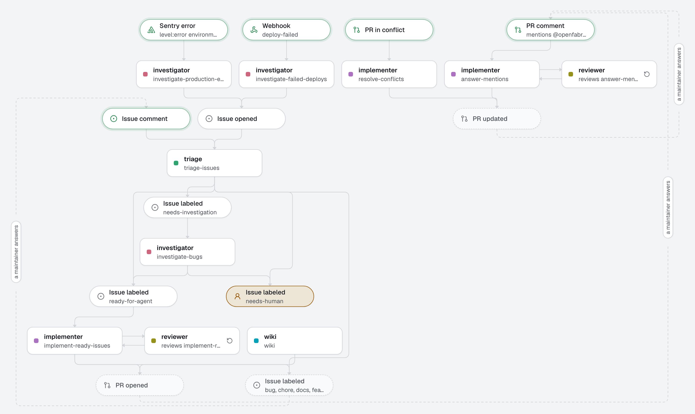

# 02: SDLC, from issue to ready pull request

A standing engineering factory: triage checks the issue is a usable contract, an agent investigates bugs with an unknown cause, another implements, a third reviews its change adversarially before the pull request exists, and a human merges. New production errors (Sentry) and failed deploys (a webhook) enter the same flow as investigated issues, and agents read up-to-date library documentation through an MCP server.

It shows most of the format in one place: labels and pull requests that chain the steps; an internal review (`reviewed_by`); an integration, a webhook and an MCP server; the harness (`setup`, `commands`, `checks`); shared and per-agent skills.

It follows Warp's [`02-sdlc-issue-to-pr`](https://github.com/warpdotdev/warp-factory-examples/tree/main/examples/02-sdlc-issue-to-pr) example, with two differences: there is no foreman, the stages chain through GitHub events (labels, pull requests), and the engine itself runs the loop between the implementer and the reviewer; and each automation lists what the engine may write for its agent (`can`). It is also the flow tested against Archon on November 1st, 2026, on the same test repository, so both can be compared on the same requests.

## What this factory does



The review happens on the machine, before anything reaches GitHub: when the implementer finishes and the checks pass, the engine runs the reviewer on its change, and sends the findings back to the implementer until the reviewer approves. The pull request then opens clean, with one line on the review and the labels `ready-to-merge` and `risk:low`, `risk:medium` or `risk:high`: `is:pr label:ready-to-merge label:risk:low` lists what merges in a minute. When the reviewer asks for a person, or after 3 rounds (`review_rounds`), it opens with `needs-human` and only the findings still open. The rounds are in the run's page of the studio. The only planned human steps: answering questions on an incomplete issue, and merging. Between the two, a maintainer can ask for a change in a comment on the pull request: `@openfabriq rename this function` sends the implementer back to it, and the reviewer reads that change too.

## Tree

```
openfabriq/
├── factory.yaml                     repository, maintainers, the checks run before any pull request, limits
├── agents/
│   ├── triage/agent.md              labels the kind of work, checks the contract, picks the next step
│   ├── investigator/agent.md        proves the cause of a bug, fixes nothing
│   ├── implementer/agent.md         implements test first and opens the pull request (opus)
│   └── reviewer/agent.md            reviews the change before the pull request exists (opus)
├── automations/
│   ├── triage-issues/               when: issue.opened, issue.commented
│   ├── investigate-bugs/            when: issue.labeled needs-investigation
│   ├── investigate-production-errors/   when: sentry.issue.created level:error environment:production
│   ├── investigate-failed-deploys/  when: webhook.received deploy-failed
│   ├── implement-ready-issues/      when: issue.labeled ready-for-agent, reviewed by reviewer
│   ├── resolve-conflicts/           when: pull_request.conflicted
│   └── answer-mentions/             when: pull_request.commented mentions @openfabriq, reviewed by reviewer
└── skills/
    ├── test-driven-development/SKILL.md          test first, red then green, the failing run as proof
    └── browser-evidence/SKILL.md                 check a visible change with agent-browser, screenshots as proof
```

## Proof in a browser

When a change shows in the app, the implementer checks it with [agent-browser](https://github.com/vercel-labs/agent-browser) and commits one screenshot per visible acceptance criterion in `evidence/<issue>/`; the pull request description shows each one under the criterion it proves. The reviewer changes nothing, so it attaches nothing: it runs the same scenario in its own browser and says, criterion by criterion, whether the browser agrees with the screenshots. Install it once on the engine's machine: `openfabriq doctor` prints the command, from the skill's `compatibility` (the engine's Docker image has it). Drop `evidence/` before merging if you do not want the screenshots in your history.

The reviewer runs on a different model than the one the factory uses by default, so the two do not share blind spots.

## What the person who merges reads

Beyond the tests and the screenshots, the implementer's pull request description says how closely to look: **Scope** ties each changed file to the acceptance criterion it serves, so a change nobody asked for stands out; **Rollback** says whether a revert undoes the change, or what it leaves behind (a migration that drops data, an email already sent); **Failure in production** says how a failure would show: an error reported to Sentry, a log line, or nothing. The reviewer checks the three against the change before the pull request opens: a missing or wrong one goes back to the implementer, and a change no revert undoes goes to a person.

## Make it yours

1. Copy the `openfabriq/` folder to the root of your repository.
2. In `factory.yaml`, replace `repository` and `maintainers`, the `setup` and `commands` with your project's own, and the Sentry `organization` and `project`.
3. Put your stack, commands and conventions in your repository's `CLAUDE.md`, which every agent reads first. In the skills, use your real test commands and the command that starts your app. Nothing to see in a browser (an API, a library)? Delete `skills/browser-evidence/` and the steps that name it in the implementer and the reviewer.
4. Run `openfabriq plan`: it lists the labels it will create (`ready-for-agent`, `needs-info`, `needs-investigation`, `needs-human`, `ready-to-merge` and `risk:low`, `risk:medium`, `risk:high`, which the engine puts on the pull requests the reviewer approved, and the kinds of work `bug`, `feature`, `docs`, `chore` when the repository lacks them), and, as security changes, the Sentry integration, the webhook and the MCP server.
5. `openfabriq apply`.
6. Connect the services, on the machine that runs the engine:
   - `openfabriq connect relay` (once, on your Cloudflare account or `--url` for a self-hosted relay): Sentry and the webhook both come through it;
   - `openfabriq connect sentry`: a token with `project:read`, `event:read` and `event:write`;
   - `openfabriq connect webhook deploy-failed`: it prints the URL and the `whsec_` secret to give your deploy platform (any sender that follows [Standard Webhooks](https://www.standardwebhooks.com));
   - the `docs` MCP server ([Context7](https://context7.com)) needs nothing: its tools are read-only and listed per agent.
   Not using Sentry? Delete `automations/investigate-production-errors/` and the `integrations` key. Not using the webhook? Delete `automations/investigate-failed-deploys/` and the `webhooks` key. The `from: factory` lines can stay: they only let the chain go on from what the factory wrote in a run that Sentry or a webhook started.
7. `openfabriq start`.
