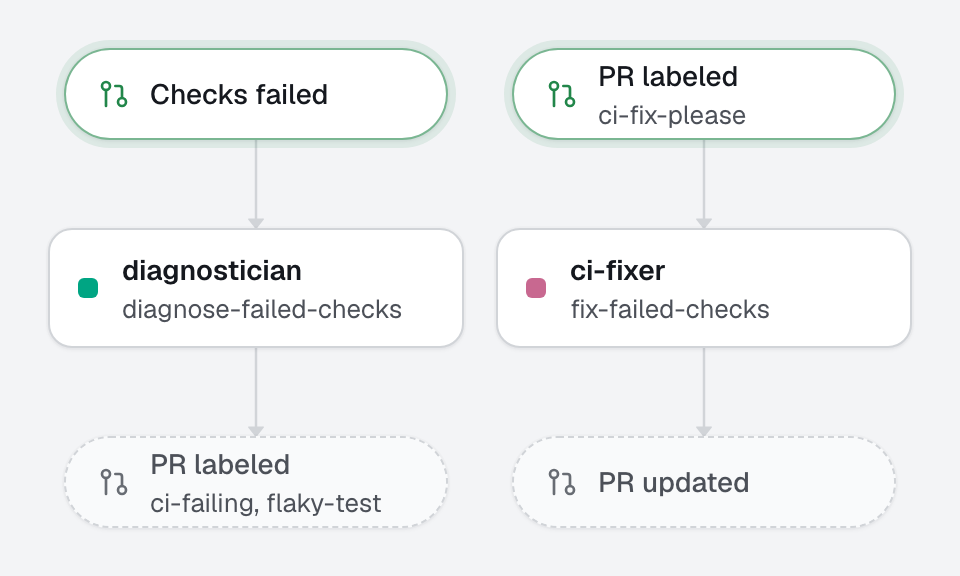

# 06: CI doctor, from a red check to its exact fix

A failing check is a puzzle someone has to read a log to solve. Here, when the checks of a pull request fail, an agent reads the failed logs, finds the cause in the code, and comments it with the exact fix. It labels the pull request `ci-failing`, and `flaky-test` when it can show the failure is a flake. If a maintainer wants the factory to make the fix itself, they add `ci-fix-please`, and a second agent pushes it.

## What this factory does



## Why the diagnostician cannot push

The engine refuses `push_to_pull_request` on any automation that listens to `pull_request.checks_failed`, and `validate` says so. A push starts the CI again; if it fails again, `checks_failed` fires again, the agent pushes again, and the loop burns your budget on a red pull request. So the agent that reacts to a red check only comments.

The fix goes through a person: the `ci-fix-please` label is the decision to let an agent push, one pull request at a time. That automation listens to `pull_request.labeled`, not `checks_failed`, so it may push. When its push fails CI again, the diagnostician comments again, and nothing pushes until a maintainer adds the label again.

## Least privilege

- The agents have no GitHub access. The engine reads the failed jobs' logs (`gh`) and hands the end of each one to the diagnostician.
- Neither agent has `shell`. They have `commands`: they can run the named commands of `factory.yaml` (`test`, `lint`, `typecheck`, `build`) and nothing else. Without git, the fixer commits through the engine's `commit` tool: it names the files it changed, and the engine commits exactly those.
- The fixer has `edit`; the engine still runs the `checks` before pushing, and refuses the push if one fails, or if it touches `.github/workflows/`.
- Labels are restricted: the diagnostician may only add `ci-failing` and `flaky-test`; the fixer may only remove `ci-fix-please` and `ci-failing`.

## Tree

```
openfabriq/
├── factory.yaml                          setup, commands and the checks the engine runs before a push
├── agents/
│   ├── diagnostician/agent.md            reads the logs, finds the cause, changes nothing
│   └── ci-fixer/agent.md                 fixes the cause, never the check
└── automations/
    ├── diagnose-failed-checks/           when: pull_request.checks_failed
    └── fix-failed-checks/                when: pull_request.labeled ci-fix-please
```

## Make it yours

1. Copy the `openfabriq/` folder to the root of your repository.
2. In `factory.yaml`, replace `repository`, `maintainers`, `setup` and the `commands`, so they match what your CI runs.
3. Do you want comments only? Delete `agents/ci-fixer/` and `automations/fix-failed-checks/`.
4. Run `openfabriq plan`: it lists the labels it will create (`ci-failing`, `flaky-test`, `ci-fix-please`) and the commands as security changes.
5. `openfabriq apply`, then `openfabriq start`.
6. `ci-failing` is not removed when a later push turns the checks green. Remove it by hand, or let the fixer do it.
