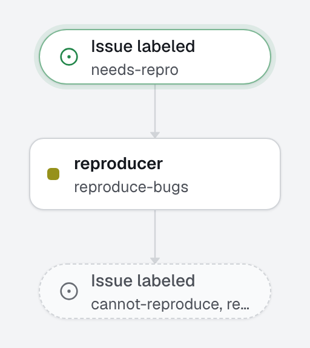

# 07: Bug reproducer

Before anyone fixes a bug, someone has to see it. A maintainer adds `needs-repro` to a bug report; an agent follows the steps on the default branch, writes the smallest test that fails because of the bug, and posts on the issue the exact command, its output and the test itself. It ends with `reproduced`, or `cannot-reproduce` and precise questions for the author. It fixes nothing.

## What this factory does



`needs-repro` is removed in both cases, so adding it again (after the author answered) starts a new attempt.

## Why the test is not committed

The reproducer cannot open a pull request. A pull request that only adds a failing test would fail your CI, and a factory with `checks` refuses to publish code that fails them. So the test lives in the comment, in full, with the path where it belongs: whoever fixes the bug, a person or an agent, starts from it, and it becomes the regression test of the fix.

## Bugs in the interface

When the bug shows in the app, the reproducer follows the `browser-evidence` skill: it starts the app with the `dev` command and walks the steps with [agent-browser](https://github.com/vercel-labs/agent-browser). It does not push, so it cannot attach screenshots: it describes what each step showed (the address, the element, the exact text on screen).

## Tree

```
openfabriq/
├── factory.yaml                          setup, and the test and dev commands
├── agents/
│   └── reproducer/agent.md               follows the steps, writes a failing test, fixes nothing
├── automations/
│   └── reproduce-bugs/                   when: issue.labeled needs-repro
└── skills/
    └── browser-evidence/SKILL.md         walk a scenario in a real browser, describe what it showed
```

## Least privilege

The reproducer has `read`, `shell` and `commands`, and no `edit`: it writes its test with the shell in its own worktree, runs it, and deletes it before finishing. It may only comment, add its two labels and remove `needs-repro`. It never opens a pull request, so nothing it writes reaches a branch.

## Make it yours

1. Copy the `openfabriq/` folder to the root of your repository.
2. In `factory.yaml`, replace `repository`, `maintainers`, `setup` and the `test` and `dev` commands.
3. For bugs in the interface, install agent-browser on the engine's machine: `openfabriq doctor` prints the command, from the skill's `compatibility` (the engine's Docker image has it).
4. Run `openfabriq plan`: it lists the labels it will create (`needs-repro`, `reproduced`, `cannot-reproduce`).
5. `openfabriq apply`, then `openfabriq start`.
6. Add `needs-repro` to a bug report.

With `02-sdlc`, a reproduced bug goes on with a person's label: `needs-investigation` when the cause is unknown, `ready-for-agent` when the fix is obvious.
