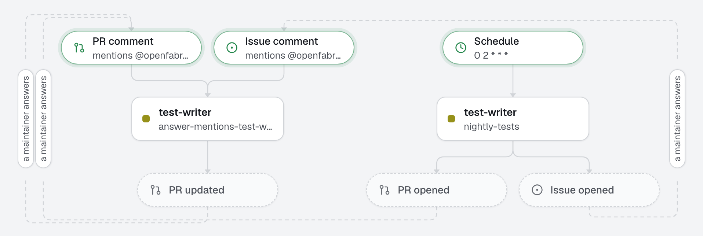

# 08: Nightly test coverage

Coverage rises a little every night, on its own. At 02:00 an agent runs the coverage report, picks the module with the fewest tests, and opens a pull request that adds behavioral tests for it: tests that describe what the code does, through its public functions, without changing a line of production code. When a test shows the code is wrong, the agent does not bend the test to pass: it opens an issue with the failing test, and no pull request. A human merges.

## What this factory does



Before the pull request leaves the machine, the engine runs the `checks` (`test`, `lint`, `typecheck`): code that fails them is not published, so a nightly pull request never arrives red.

## Tree

```
openfabriq/
├── factory.yaml                          timezone, setup, commands (coverage among them) and checks
├── agents/
│   └── test-writer/agent.md              tests one module per night, touches no production code
└── automations/
    └── nightly-tests/                    when: schedule "0 2 * * *"
```

## Notes

- **The coverage report is read from a file.** `run_command` only returns the end of a command's output, so the `coverage` command writes `coverage/coverage-summary.json` (Vitest's `json-summary` reporter), which the agent reads. Vitest needs its coverage provider for that: `pnpm add -D @vitest/coverage-v8`. Make your `coverage` command write a similar summary, and keep `coverage/` in `.gitignore`.
- **One pull request at a time.** The agent works from the default branch and cannot see open pull requests: if last night's pull request is still open, tonight's run may pick the same module. Merge or close it during the day, or run on weekdays only (`"0 2 * * 1-5"`).
- **A scheduled run has no issue to comment on**, so the automation may only open a pull request or an issue. With `02-sdlc`, the issue it opens goes to triage like any other.
- **Nothing runs while the machine sleeps.** A missed night is caught up once on waking. To run on time, wake the machine just before: `sudo pmset repeat wakeorpoweron MTWRFSU 01:55:00`.

## Make it yours

1. Copy the `openfabriq/` folder to the root of your repository.
2. In `factory.yaml`, replace `repository`, `maintainers`, `timezone`, `setup` and the commands, then keep in `checks` the ones that must pass before a pull request.
3. Run `openfabriq plan`, then `openfabriq apply` and `openfabriq start`.
4. To try it without waiting for the night: `openfabriq run nightly-tests`.
