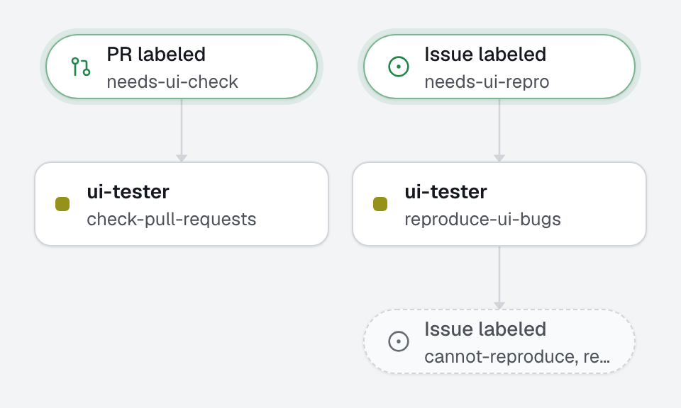

# 09: UI check in a real browser

Tests say the code does what it was told; someone still has to click through the page. A maintainer adds `needs-ui-check` to a pull request: an agent starts the app on the pull request's branch, walks every visible behavior it promises with [agent-browser](https://github.com/vercel-labs/agent-browser), then tries the same pages at phone width and with the keyboard, and comments what works and what does not. Add `needs-ui-repro` to a bug report instead, and it walks the report's steps on the default branch. It is advisory: it never pushes, never approves, never blocks. A human decides.

## What this factory does



The label that started a run is removed at the end, so adding it again checks the next version.

## The browser-evidence skill, reviewer side

Everything this agent does goes through the `browser-evidence` skill: start the app with the `dev` command in the background, read the page with `agent-browser snapshot -i`, act on its elements, check one promise at a time. The skill also says how an agent that delivers code commits screenshots as proof; this one cannot push, so it attaches nothing and describes what it saw instead (address, element, exact text). When the pull request carries screenshots, it says whether the browser agrees with them.

## Tree

```
openfabriq/
├── factory.yaml                          setup, and the dev command that starts the app
├── agents/
│   └── ui-tester/agent.md                walks the app, reports what it saw, changes nothing
├── automations/
│   ├── check-pull-requests/              when: pull_request.labeled needs-ui-check
│   └── reproduce-ui-bugs/                when: issue.labeled needs-ui-repro
└── skills/
    └── browser-evidence/SKILL.md         walk a scenario in a real browser, and show what it showed
```

## Least privilege

The agent has `read`, `shell` (to start the app and drive the browser) and `commands`, and no `edit`. Its automations may only comment and move their own labels: no push, no review, no `request_changes`. The `dev` command runs the pull request's code on the engine's machine, inside the shell sandbox; that is why only maintainers can add `needs-ui-check`. Look at the diff before you add it to a pull request from outside the team.

## Make it yours

1. Copy the `openfabriq/` folder to the root of your repository.
2. In `factory.yaml`, replace `repository`, `maintainers`, `setup` and the `dev` command. If your app does not answer on `http://localhost:3000`, change the address in `skills/browser-evidence/SKILL.md`.
3. Install agent-browser on the engine's machine: `openfabriq doctor` prints the command, from the skill's `compatibility` (the engine's Docker image has it).
4. Run `openfabriq plan`: it lists the labels it will create (`needs-ui-check`, `needs-ui-repro`, `reproduced`, `cannot-reproduce`).
5. `openfabriq apply`, then `openfabriq start`.
6. Add `needs-ui-check` to a pull request, or `needs-ui-repro` to a bug report.

If the app needs test data, seed it in `setup`, and use only test accounts: the agent describes what it sees in public comments.
