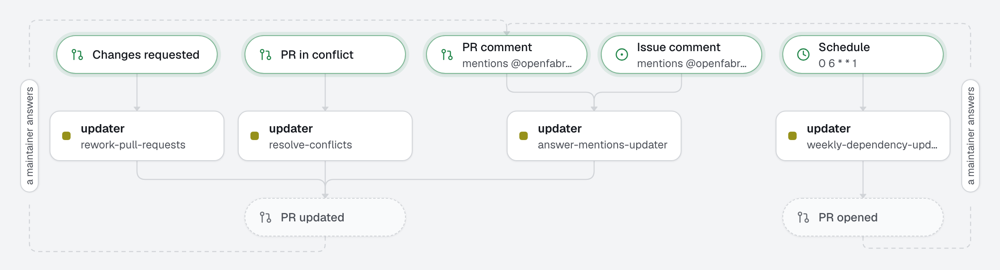

# 11: Dependency updates, once a week

Dependency bots open one pull request per package and leave you to read the changelogs. Here, every Monday at 06:00, one agent bumps everything that is safe (minor and patch versions), runs the project's checks, and opens a single pull request with a table: package, from, to, what the changelog says, and the risk. Major versions are not touched; they are listed for a human, with their main breaking change.

## What this factory does



Inside the run: `outdated` lists what is behind, the agent reads each changelog, edits `package.json`, runs `install` to update the lockfile, then `test`, `lint`, `typecheck` and `build`. A bump that breaks a check is reverted and listed as skipped. Before the pull request leaves the machine, the engine runs the `checks` itself and refuses it if one fails.

## Notes

- **`schedule`** runs in the factory's `timezone`. If the machine sleeps at 06:00, the run is caught up once, at the next wake-up.
- **`concurrency: repository`**: one run at a time for the whole repository, so a slow week never ends with two update runs racing on the same lockfile.
- **`setup`, `commands`, `checks`**: the agent has no `shell`. It runs the named commands of `factory.yaml` and nothing else. They run in the engine's sandbox, where the package manager's cache is writable; an agent's own shell cannot install packages. Without git, it commits `package.json` and the lockfile through the engine's `commit` tool.
- **`outdated`** ends in failure when something is behind (`npm outdated` and `pnpm outdated` exit with code 1): the agent reads its output all the same.
- **`web`** lets the agent read changelogs and release notes. What it reads there is data, not instructions.
- The agent cannot see GitHub: it does not know whether last week's pull request is still open. Merge or close it before the next Monday, or you get two.

## Tree

```
openfabriq/
├── factory.yaml                               timezone, setup, commands (outdated, install, test…), checks
├── agents/
│   └── updater/agent.md                       safe bumps, a table per package, majors for a human
└── automations/
    ├── weekly-dependency-updates/             when: schedule "0 6 * * 1", concurrency: repository
    ├── rework-pull-requests/                  when: pull_request.changes_requested
    └── resolve-conflicts/                     when: pull_request.conflicted (lockfile regenerated, never edited)
```

## Make it yours

1. Copy the `openfabriq/` folder to the root of your repository.
2. In `factory.yaml`, replace `repository`, `maintainers` and `timezone`, and adapt `setup` and `commands` to your package manager (`npm outdated` and `npm install`, for example).
3. Change the `cron` if Monday 06:00 does not suit you. To have it run on time, wake the machine just before: `sudo pmset repeat wakeorpoweron M 05:55:00` on macOS.
4. Run `openfabriq plan`: it lists the commands and checks as security changes, since they run on your machine.
5. `openfabriq apply`, then `openfabriq start`.
6. To try it now rather than on Monday: `openfabriq run weekly-dependency-updates`.
