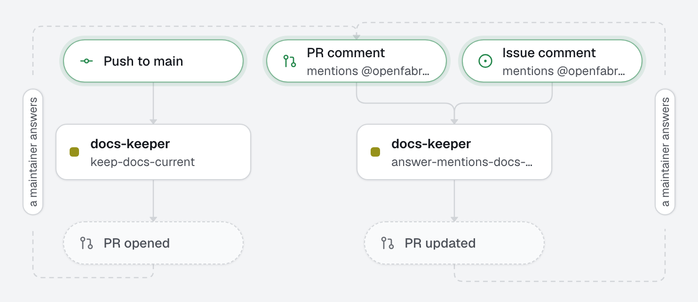

# 12: Docs drift, the README that keeps up

Documentation goes stale one merged pull request at a time: a flag renamed, a default changed, a new option nobody wrote down. Here, every time commits land on the default branch, an agent reads them, checks that the README and `docs/` still say what the code does, and opens a docs-only pull request when they drifted. Most of the time it finds nothing and does nothing.

## What this factory does



## Not a loop

Merging the docs keeper's own pull request updates the default branch, which starts the docs keeper again. The agent is told to recognize that case: when the latest commits only touch documentation and start with `docs: sync with`, the title it gives its own pull requests, it stops. Keep that title (or squash-merge with it) so it can tell.

## Notes

- `default_branch.updated` has no author to check: GitHub already controls who can write to the default branch.
- `concurrency: repository`: a burst of merges runs one docs check at a time. The agent cannot see GitHub: while its docs pull request is open, the next run does not know it, and can open another one for the same commits. The latest one covers them all: merge it, and close the older ones.
- The agent has `edit` and `shell` (for `git log`), and the automation only allows `create_pull_request`: it cannot comment, label or push to another pull request.
- Its pull requests only touch docs, so a code review automation with `ignore_paths: ["docs/**", "**/*.md"]` (see `05-code-review`) leaves them alone.

## Tree

```
openfabriq/
├── factory.yaml
├── agents/
│   └── docs-keeper/agent.md            reads new commits, fixes the docs only, stops on its own merges
└── automations/
    └── keep-docs-current/              when: default_branch.updated, concurrency: repository
```

## Make it yours

1. Copy the `openfabriq/` folder to the root of your repository.
2. In `factory.yaml`, replace `repository` and `maintainers`.
3. In the agent, change the line "The docs you keep": the docs it should keep (`README.md`, `docs/`, a `website/` folder…) and what never to touch (a changelog, generated API docs).
4. Run `openfabriq plan`, `openfabriq apply`, then `openfabriq start`.
5. To check the current state once without waiting for a merge: `openfabriq run keep-docs-current`.
