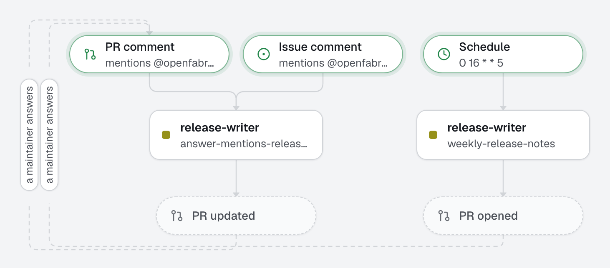

# 13: Release notes, written every Friday

Nobody likes writing the changelog the day of the release. Here, every Friday at 16:00, an agent gathers the pull requests merged since the last tag or the last CHANGELOG entry, keeps what users will notice, and opens a pull request that updates `CHANGELOG.md` in [Keep a Changelog](https://keepachangelog.com/en/1.1.0/) style: grouped under Added, Changed and Fixed, written for users, each line with its pull request number. When nothing was merged, it does nothing.

## What this factory does



You read the pull request, reword what you want, and merge it. When you cut the release, rename `[Unreleased]` to the version and tag it: next Friday starts from that tag.

## Notes

- The agent has no GitHub access, so it works from git: merge commits (`Merge pull request #N`) and squash commits (`Title (#N)`) carry the pull request numbers. Rebase merges lose them: the entry then has no number.
- `shell` is for `git log` and `git show`: the agent reads the diff when a commit message is too short to tell users what changed.
- The automation only allows `create_pull_request`. If last week's pull request is still open, the agent cannot see it and opens a second one; merge or close it first.

## Tree

```
openfabriq/
├── factory.yaml                               timezone
├── agents/
│   └── release-writer/agent.md                merged pull requests → user-facing CHANGELOG entry
└── automations/
    └── weekly-release-notes/                  when: schedule "0 16 * * 5"
```

## Make it yours

1. Copy the `openfabriq/` folder to the root of your repository.
2. In `factory.yaml`, replace `repository`, `maintainers` and `timezone`.
3. Change the `cron` to your release rhythm (`0 16 * * 5` is Friday 16:00).
4. If your changelog is not `CHANGELOG.md`, or uses other sections, say it in the agent's Output.
5. Run `openfabriq plan`, `openfabriq apply`, then `openfabriq start`.
6. To try it now: `openfabriq run weekly-release-notes`.
