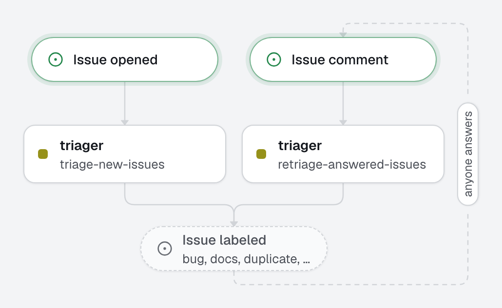

# 14: Issue triage, a first answer in minutes

An open project's issue tracker fills faster than maintainers can read it. Here, every new issue is classified (bug, feature, question, docs, duplicate), gets a priority from a fixed list, and a first answer: the likely place in the code for a bug, the answer itself for a question, the original for a duplicate. A report that lacks what is needed to act gets `needs-info` and precise questions; when the author answers, the issue is triaged again.

## What this factory does



## Who can start it

Issues on an open project come from anyone, so both automations have `from: anyone`; `openfabriq plan` shows it as a security change. What keeps it safe:

- The triager has only `read`: no `edit`, no `shell`, no `web`.
- The labels are listed in `can`: `add_labels: [...]` lets the engine add these nine and refuse any other, and only the re-triage may remove a label, `needs-info`.
- It can comment, and close a new issue it calls a duplicate, and nothing else: no pull request, no review. `close_issue` closes only the issue the run is about, so a stranger's issue can at most close itself; a maintainer reopens it in one click.
- `limits` are low: a triage run is short, and `usd_per_day` caps what a flood of issues can cost.

The engine's own comments never trigger an automation, so the triager's questions do not start a re-triage.

## Notes

- The agent has no GitHub access, so it cannot search other issues. It calls an issue a duplicate only when it can name the original: linked in the issue, or found in `CHANGELOG.md` or the docs.
- Type labels are GitHub's defaults except `feature` and `docs`. Rename them in both automations and in the agent if your repository uses `enhancement` and `documentation`.

## Tree

```
openfabriq/
├── factory.yaml
├── agents/
│   └── triager/agent.md                    type, priority, first answer; asks when details are missing
└── automations/
    ├── triage-new-issues/                  when: issue.opened, from: anyone
    └── retriage-answered-issues/           when: issue.commented, from: anyone, only acts on needs-info
```

## Make it yours

1. Copy the `openfabriq/` folder to the root of your repository.
2. In `factory.yaml`, replace `repository` and `maintainers`.
3. Adjust the priority definitions in the agent to what high, medium and low mean for your project.
4. For a private repository where only your team opens issues, remove `from: anyone`: only `maintainers` then start it.
5. Run `openfabriq plan`: it lists the labels it will create and `from: anyone` as a security change.
6. `openfabriq apply`, then `openfabriq start`.
