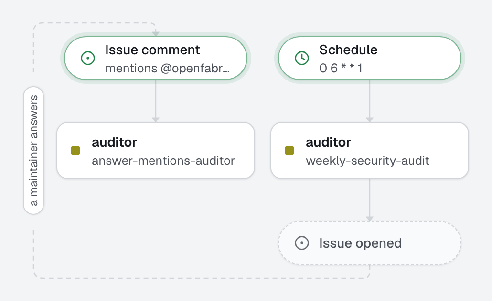

# 15: Weekly security audit

A security pass every Monday morning, before anyone asks. An agent runs the dependency audit, reads the code where attacks come in (authentication, permissions, every place outside input reaches a query, a command, a file or a page), and opens one issue per real finding: severity, location, exploit scenario in words, fix. It changes nothing and exploits nothing. A finding it cannot explain end to end is not reported.

## What this factory does



## Duplicates: what the factory does, and what it cannot do

The agent cannot read GitHub, so it cannot see the issues it opened last week. Two things keep the same finding from coming back every Monday:

- **A fingerprint in every title**, built from what the finding is (`sec-dep-lodash-GHSA-…`, `sec-code-sqli-src/db/users.ts-searchUsers`), never from a line number. Search it on GitHub to find every issue about one finding.
- **`security/known-findings.md`**, a file you keep in the repository: one fingerprint per line, with a word on why (filed as #42, accepted risk, false positive). The agent reads it and skips what it lists. Add a fingerprint when you triage an issue, in the same pull request as the fix or on its own.

Until a fingerprint is in that file, next Monday's run opens the same finding again. That is deliberate: a finding nobody triaged is not forgotten.

## Who sees the issues

Issues are public on a public repository, and an exploit scenario helps attackers too. Run this factory on a private repository, or point it at a private fork. For a critical finding, use GitHub's private security advisories by hand.

## Least privilege

The auditor has `read`, `shell` and `commands`, and no `edit`. Its automation may only open issues: a scheduled run has no issue or pull request to comment on or label, and it never touches code. It is told never to exploit a finding and never to copy a secret's value into an issue.

## Tree

```
openfabriq/
├── factory.yaml                          timezone, setup, the audit command
├── agents/
│   └── auditor/agent.md                  finds vulnerabilities it can explain, changes nothing
└── automations/
    └── weekly-security-audit/            when: schedule "0 6 * * 1"
```

## Make it yours

1. Copy the `openfabriq/` folder to the root of your repository.
2. In `factory.yaml`, replace `repository`, `maintainers`, `timezone`, `setup` and the `audit` command (`npm audit --omit=dev --json`, `pip-audit -f json`, `bundle audit`…), keeping the report in a file: the agent only gets the end of a command's output.
3. Add `audit-report.json` to `.gitignore`, and create `security/known-findings.md` (it may start empty).
4. Run `openfabriq plan`, then `openfabriq apply` and `openfabriq start`.
5. To try it without waiting for Monday: `openfabriq run weekly-security-audit`.
