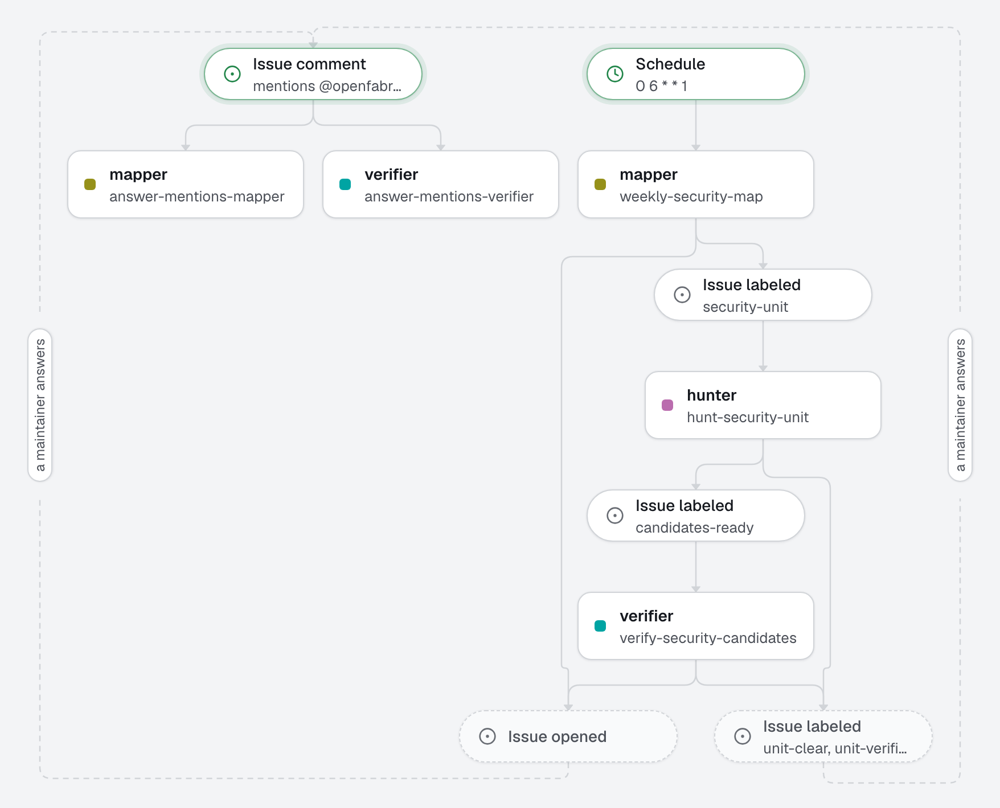

# 16: Security review, with a verifier

[15-security-audit](../15-security-audit) is one agent that audits and reports. This is the heavier version, for a repository where a false alarm costs a day: one agent finds, another tries to prove it wrong, and only what survives becomes an issue. The finder is never the verifier, and the verifier runs on a stronger model. It changes nothing and exploits nothing.

The shape comes from Cloudflare's [security-audit skill](https://github.com/cloudflare/security-audit-skill) (MIT): isolated hunters per surface, a fresh verifier that tries to disprove each candidate, and a verdict that keeps "confirmed" apart from "cannot tell from the code". The skill itself needs sub-agents and an OS sandbox; here every role is an ordinary openfabriq agent and the roles are chained through GitHub.

## What this factory does



Three agents, three automations, no sub-agents: one unit issue is one hunter run, so the hunters work in parallel on their own, and each run keeps its own cost, time limit and transcript in the app.

## Why it is more than 12

- **A verifier that starts fresh.** It gets the candidates, not the hunter's conviction, and its brief is to disprove them: find the validator, the permission check, the test that pins the safe behavior. A candidate it cannot disprove, and can retrace itself, is a finding.
- **Three verdicts, not two.** "Confirmed" has a retraced path and a stated impact. "Needs validation" names the single fact that lives outside the repository (a proxy, a cloud policy). "Rejected" says which control it found. Only "confirmed" gets a severity and an issue.
- **A different place to look each week.** The mapper ranks surfaces and skips those audited in the last 90 days that have not changed, so a week covers new ground instead of repeating the top five.

## What a person keeps

Two small files in the repository, both read by the agents and written by you, in the same pull request as a fix or on their own:

- **`security/known-findings.md`**: one fingerprint per line, with a word on why (filed as #42, accepted risk, false positive). Findings listed there are skipped. The agents cannot read GitHub, so this file is how last week's findings are remembered.
- **`security/audit-log.md`**: one line per unit, `<slug> <date>`, when a unit has been looked at. The unit issue says its slug. Without a line, the mapper picks the unit again next Monday.

## Costs and limits

A week is one mapper, up to five hunters and up to five verifiers: eleven runs, the verifiers on the dearest model. `limits.usd_per_day` caps the day; raise or lower the five in the mapper's brief to fit your budget. Only units start a hunter: the engine puts the `security-unit` label on every issue the mapper opens (`create_issue: [security-unit]`), and the hunter listens to that label, so the finding issues the verifier opens start nothing.

## Who sees the issues

Unit issues and the hunter's and verifier's comments are public on a public repository, and a candidate that was later rejected is still written down there. Run this factory on a private repository or a private fork. For a critical finding, use GitHub's private security advisories by hand.

## Least privilege

No agent has `edit`. The mapper may only open unit issues, which the engine labels `security-unit`. The hunter may only comment, add `candidates-ready` or `unit-clear`, and close its unit when nothing holds. The verifier may only open finding issues, comment, add `unit-verified`, and close its unit. A unit with a `needs-validation` candidate stays open: the person who checks the missing fact closes it. Each is told never to exploit and never to copy a secret.

`close_issue` closes only the issue the run is about, never another one: a hunter or a verifier can only close its own unit. A closed issue reopens in one click. To hand a surface to a hunter yourself, open an issue like the mapper's and add the `security-unit` label.

## Tree

```
openfabriq/
├── factory.yaml                          timezone, setup, the audit command, limits
├── agents/
│   ├── mapper/agent.md                   ranks the surfaces, opens the units
│   ├── hunter/agent.md                   finds candidates it can explain in one unit
│   └── verifier/agent.md                 tries to disprove them, on a stronger model
└── automations/
    ├── weekly-security-map/              when: schedule "0 6 * * 1"
    ├── hunt-security-unit/               when: issue.labeled security-unit
    └── verify-security-candidates/       when: issue.labeled candidates-ready
```

## Make it yours

1. Copy the `openfabriq/` folder to the root of your repository.
2. In `factory.yaml`, replace `repository`, `maintainers`, `timezone`, `setup` and the `audit` command (`npm audit --omit=dev --json`, `pip-audit -f json`, `bundle audit`…), keeping the report in a file: the agent only gets the end of a command's output.
3. Add `audit-report.json` to `.gitignore`, and create `security/known-findings.md` and `security/audit-log.md` (both may start empty).
4. Run `openfabriq plan`: it lists the labels it will create. Then `openfabriq apply` and `openfabriq start`.
5. To try it without waiting for Monday: `openfabriq run weekly-security-map`.

The engine writes with the `gh` account it runs under, and it trusts that account, so the issues and labels it writes start the next stage even when that account is not in `maintainers`.
