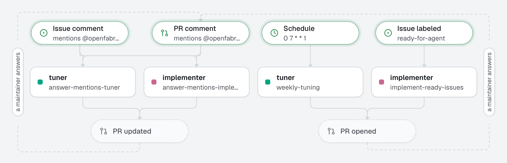

# 17: Factory tuner

A factory's agents make the same mistakes until someone rewrites their brief. People already say what went wrong, on GitHub: they close a pull request, request changes, fix it by hand, or pick up an issue the engine handed over. Once a week, a tuner reads those reactions and proposes one small change to one agent's brief or skill, with the evidence: the pull requests, and what people wrote on them. A human reviews it with `openfabriq plan` and merges it. The engine never merges a change to `openfabriq/` on its own, whatever the factory allows.

## What this factory does



The implementer is the one of [01-quickstart](../01-quickstart/): it gives the tuner something to read. In your factory, the tuner reads the work of all your agents. To run this folder as it is, add your project's `setup` and its test command to `factory.yaml`, so the implementer's tests have their dependencies.

## What the tuner reads

The agents have no GitHub token, so the `history` command reads GitHub for the tuner. It runs `scripts/factory-history.mjs`, which writes `factory-history.md` in the run's checkout:

- the factory's pull requests updated in the last 28 days, recognized by their `openfabriq/` branch, grouped by the agent that the engine's signature names;
- for each one, whether it was merged, closed without merge or is still open, and what humans wrote on it: reviews, change requests, inline and plain comments;
- the issues and pull requests labeled `needs-human`, with the engine's reason.

The engine's own reviews and comments are left out: they carry its invisible mark. Everything the file quotes is data written by others, and the tuner's brief says so.

The tuner has no `shell`: it commits through the engine's `commit` tool, which keeps only the files it names, so `factory-history.md` never leaves the run.

## A strict scope, written down

- **Evidence first.** A pattern counts when it comes back on at least two pull requests or hand-offs. One angry comment does not; a merged pull request with no comment is the agent working.
- **One change a week.** One pull request, on one agent, one automation or one skill, 60 changed lines at most. Its description names the pattern, links the evidence, explains the change and says what to watch next week.
- **Never what an agent can reach.** The tuner edits the text of briefs, automation prompts and skills. It never edits a header (`tools`, `mcp`, `when`, `can`), `factory.yaml` or `scripts/`, and never its own brief. When the history points there, it writes a suggestion for a human in its description instead.
- **The factory still loads.** `validate` is the factory's check: the engine refuses a pull request whose factory no longer validates.

## Tree

```
openfabriq/
├── factory.yaml                                the history and validate commands, the token's name
├── agents/
│   ├── implementer/agent.md                    turns an issue into a pull request
│   └── tuner/agent.md                          one change to the factory a week, with its evidence
├── automations/
│   ├── implement-ready-issues/automation.md    when: issue.labeled ready-for-agent
│   └── weekly-tuning/automation.md             when: schedule "0 7 * * 1"
└── scripts/
    ├── factory-history.mjs                     the history command: GitHub → factory-history.md
    └── test/factory-history-test.mjs           runs it against a fake GitHub
```

## Make it yours

1. Copy `agents/tuner/`, `automations/weekly-tuning/` and `scripts/` into your factory's `openfabriq/` folder.
2. In your `factory.yaml`, add the `history` and `validate` commands with your repository's name, `validate` to `checks`, and `FACTORY_HISTORY_TOKEN` to `secrets`.
3. Create a fine-grained personal access token on GitHub, for this repository only, with **Pull requests** and **Issues** in read-only, and nothing else. Then `openfabriq secret set FACTORY_HISTORY_TOKEN`.
4. Run `openfabriq plan`, then `openfabriq apply`.
5. Try it now: `openfabriq run weekly-tuning`. With no pull request from the factory in the last 28 days, it opens nothing.

The token reaches every command of the factory, as all `secrets` do, including your tests, which run the branch's code. That is why it reads only pull requests and issues of one repository, and not its code. While last week's tuning pull request is still open, the tuner opens nothing: merge or close it within the week.

When the engine writes to GitHub with your own account, its pull requests are yours, and GitHub does not let you request changes on them. Close them with a reason, or comment: the tuner reads both.
