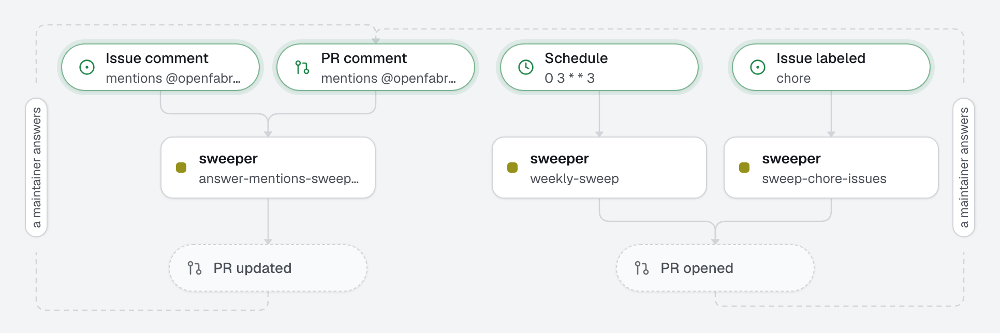

# 18: Tech debt sweeper

Technical debt rarely gets a sprint; it can get a small pull request a week. An agent removes one piece of debt at a time (a function nothing calls, a TODO three years old, a deprecated call with a documented replacement), proves it changes nothing, and opens a pull request small enough to review in two minutes. It starts on an issue labeled `chore`, or every Wednesday on its own. The checks must pass before anything leaves the machine, and a human merges.

## What this factory does



## A strict scope, written down

The agent's brief names the three kinds of cleanup it may make, and a budget: one cleanup per pull request, 150 changed lines and 10 files at most. Over budget, it does fewer occurrences instead of a bigger pull request. It never changes behavior or a public API, never reformats around its change, never edits a test to make it pass. Each pull request shows its proof: the search that finds no use, or the deprecation note that names the replacement.

The `checks` (`test`, `lint`, `typecheck`) are the harness: the engine runs them before any pull request, and refuses code that fails them.

## Tree

```
openfabriq/
├── factory.yaml                          timezone, setup, commands and checks
├── agents/
│   └── sweeper/agent.md                  one mechanical cleanup, a budget, a list of what it never does
└── automations/
    ├── sweep-chore-issues/               when: issue.labeled chore
    └── weekly-sweep/                     when: schedule "0 3 * * 3"
```

Two automations, one agent: the same brief, two ways to start it. The weekly one may only open a pull request, since a scheduled run has no issue to comment on.

## Make it yours

1. Copy the `openfabriq/` folder to the root of your repository.
2. In `factory.yaml`, replace `repository`, `maintainers`, `timezone`, `setup` and the commands.
3. In `agents/sweeper/agent.md`, adjust the kinds of cleanup, the age of a stale TODO and the budget to your codebase.
4. Run `openfabriq plan`: it lists the `chore` label it will create. Then `openfabriq apply` and `openfabriq start`.
5. Add `chore` to an issue, or try the weekly run now: `openfabriq run weekly-sweep`.

The agent cannot see open pull requests: if last week's is still open, the next run may find the same cleanup. Merge or close it within the week.
