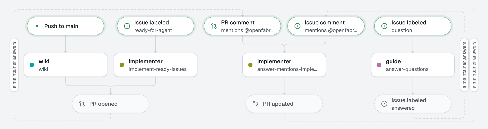

# 19: A living wiki

A map of the code that stays true. The engine writes the project's wiki once, when you ask, then updates it after each merge on the default branch: short pages that say where things live, how the pieces fit, and the words the team uses, each with the files it comes from. People read it in the studio and on GitHub; the agents read it before they open the code.

Two agents show what it is for. A guide answers questions about the code in GitHub issues, from the wiki, and links the pages and the files that prove the answer. The implementer starts from the wiki to find its way before it changes anything.

## What this factory does



## How the wiki stays true

- **Written once, on request.** Nothing runs until you click *Generate the wiki* on the studio's Wiki page, or run `openfabriq run wiki`. The first run reads the whole repository: on a large one, it can take a few runs.
- **Updated after each merge.** `refresh: after_merge` sends the wiki's agent the new commits of the default branch. It rewrites only the pages those commits make false or incomplete, and a merge that only touches `wiki/` starts nothing.
- **Reviewed like code.** Every update is a pull request that touches `wiki/` only: the engine refuses anything else. A person merges it.
- **Pages you ask for.** `openfabriq/wiki.md` adds pages to the default plan, in plain words: here billing, permissions and background jobs.

Each update is a run, with its cost: on a busy repository, `refresh: manual` and an update a week may be enough.

## Tree

```
openfabriq/
├── factory.yaml                          setup, checks, wiki: { refresh: after_merge }
├── wiki.md                               three pages to add to the wiki's plan
├── agents/
│   ├── guide/agent.md                    answers from the wiki, then checks in the code; reads only
│   └── implementer/agent.md              starts from the wiki, then delivers the issue as a pull request
└── automations/
    ├── answer-questions/                 when: issue.labeled question
    └── implement-ready-issues/           when: issue.labeled ready-for-agent
```

The wiki's agent and its automation come with the engine: they are not in `openfabriq/`. `plan` shows them in one line, and the studio marks them *built into openfabriq*.

## Make it yours

1. Copy the `openfabriq/` folder to the root of your repository.
2. In `factory.yaml`, replace `repository`, `maintainers`, `setup` and the commands. Set `wiki.folder` if your docs already live somewhere, such as `docs/wiki`.
3. In `wiki.md`, name the parts of your product a newcomer struggles with, one line each, or delete the file.
4. Run `openfabriq plan`, then `openfabriq start`, and generate the wiki once from the studio's Wiki page. Merge its pull request.
5. Label an issue `question`, or `ready-for-agent`.
