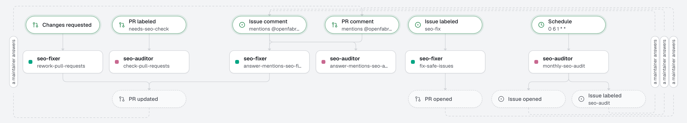

# 20: SEO audit

A factory that checks the search basics of a static site (Astro, Eleventy, Hugo, Next.js export…) from its build, without any paid service. Every month, an auditor builds the site, checks every page, and opens one issue that sorts what it found into **safe fixes** (mechanical, no text a reader sees changes) and **what a person must decide** (the words, the content). A label on that issue sends the safe fixes as a pull request. On request, the same auditor checks the pages a pull request changes.

## What this factory does



- **On the 1st of the month at 06:00**, the auditor runs `build`, then `audit`, and opens one issue, `SEO audit: <month> <year>`, labeled `seo-audit`. When the audit finds nothing, it opens nothing.
- **The `seo-fix` label on that issue** starts the fixer. It applies the safe fixes at the source (a layout fixes every page at once), runs the audit again, and opens a pull request with the problems before and after. To have it apply an item of the other list, write the exact words in a comment on the issue before you add the label.
- **The `needs-seo-check` label on a pull request** makes the auditor comment the problems on the pages that pull request adds or changes, then remove the label.

What `audit` checks, page by page, with [`scripts/seo-report.mjs`](openfabriq/scripts/seo-report.mjs): the title (present, 60 characters at most, not shared with another page), the meta description (present, 50 to 160 characters, not shared), one `<h1>`, a canonical link, the `lang` of the page, internal links that lead to no page, JSON-LD that does not parse, images without `alt`, without `width` and `height`, or over 300 KB, the pages missing from the sitemap and the sitemap's addresses that lead nowhere, and a `robots.txt` that blocks the whole site. A 404 page and a page marked `noindex` are left out.

## Notes

- **The build, not the live site.** The audit reads `dist/` as the build writes it, in the run's checkout: nothing is requested from the site in production, and a pull request is checked before it is merged. What only the live site shows (redirects, response headers, server speed) is out of its reach.
- **No paid service, no ranking.** There is no Search Console, no keyword data, no Lighthouse score: the auditor is told never to guess a ranking or a traffic figure. Links to other sites are not checked either, which would make every run depend on them.
- **The script reads HTML without a browser.** It fits a site whose pages are written at build time. A site whose content appears only once JavaScript runs needs a browser instead: see [09-ui-check](../09-ui-check).
- **One audit issue a month.** The auditor cannot read GitHub, so it does not know last month's issue: close it when the new one arrives, or when its fixes are merged.
- **`checks: [build]`**: the engine refuses a pull request whose site no longer builds. The audit is not a check: it reports, and a site with words still to write must stay mergeable.
- **The fixer never writes the site's words.** A title, a description or an `alt` text comes from a person, in a comment on the issue. `Refs #<issue>`, never `Closes`: the issue stays open for those decisions.
- **The script comes from the applied factory.** `audit: scripts/seo-report.mjs dist` runs `openfabriq/scripts/seo-report.mjs` as `apply` copied it, never the file of a pull request's branch. Its test runs it on a small fake site: `node --test 'openfabriq/scripts/test/*-test.mjs'`.

## Least privilege

The auditor has `read` and `commands`, and no `edit`: it builds and audits the site, and changes nothing. On its schedule it may only open issues, labeled `seo-audit`; on a pull request, only comment and remove `needs-seo-check`. The fixer has `edit` and may open or push a pull request, never merge it: a person reviews the changes, and your deploy ships what is merged.

## Tree

```
openfabriq/
├── factory.yaml                       timezone, setup, commands (build, audit), checks
├── scripts/
│   ├── seo-report.mjs                 the audit command: dist/ → seo-report.json
│   └── test/                          its test, on a small fake site
├── agents/
│   ├── seo-auditor/agent.md           builds, audits, sorts safe fixes from decisions, changes nothing
│   └── seo-fixer/agent.md             applies the safe fixes at the source, before and after
└── automations/
    ├── monthly-seo-audit/             when: schedule "0 6 1 * *"; can: create_issue [seo-audit]
    ├── check-pull-requests/           when: pull_request.labeled needs-seo-check; can: add_comment
    ├── fix-safe-issues/               when: issue.labeled seo-fix; can: create_pull_request, add_comment
    └── rework-pull-requests/          when: pull_request.changes_requested
```

## Make it yours

1. Copy the `openfabriq/` folder to the root of your repository.
2. In `factory.yaml`, replace `repository`, `maintainers` and `timezone`, and adapt `setup` and `build` to your site. If it builds elsewhere than `dist/` (`_site`, `public`, `out`), change the folder in `audit` too.
3. Add `seo-report.json` to `.gitignore`.
4. Run `openfabriq plan`: it lists the commands and the script as security changes, since they run on your machine. Then `openfabriq apply` and `openfabriq start`.
5. To try it now: `openfabriq run monthly-seo-audit`.
