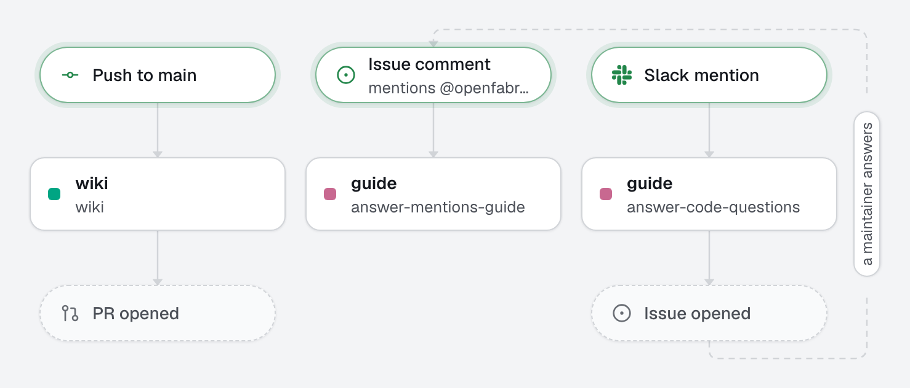

# 21: Slack codebase Q&A

A guide to the code that lives in a Slack channel. Someone asks "where do we compute the VAT?" or "why does the export skip archived users?"; the factory reads the repository and answers in the thread, with the files and lines that prove it. When someone says "file this as a bug", it opens a GitHub issue and the engine posts the link in the thread. It never changes the code.

The concept: a read-only agent. It has the `read` tool and nothing else, and the automation lets the engine write only two things for it: a reply in the thread and a new issue.

## What this factory does



The issue then enters your usual flow: combined with `02-sdlc`, `issue.opened` starts triage.

## Tree

```
openfabriq/
├── factory.yaml                       integrations.slack, low limits, wiki after each merge
├── agents/
│   └── guide/agent.md                 tools: [read]; answers from the code, never guesses
└── automations/
    └── answer-code-questions/         when: slack.mentioned; can: add_comment, create_issue
```

## Least privilege

- `tools: [read]`: the guide can read and search the checkout, nothing else. No shell, so it cannot run the code or reach the network. Add `web` if you want it to read library documentation, knowing that a page it reads is one more source of text it must treat as data.
- `can: [add_comment, create_issue]`: from Slack, `add_comment` replies in the thread. `validate` refuses labels, pushes and reviews for a run that only comes from Slack.
- Who can ask: `maintainers` are GitHub logins and do not apply to Slack. Anyone in the channel can mention the factory, so anyone in it can read the code through it and spend `usd_per_day`. Use a private channel with the people who can already read the repository.

## The wiki, after each merge

The guide answers faster when it starts from a map of the code than from a search of the whole repository. Every factory has that map, the wiki, written by an agent of the engine; here `wiki: { refresh: after_merge }` updates it after each merge on the default branch, instead of only when you ask. The first merge after `start` writes it, by pull request: merge it, and the guide reads its pages from then on. Each update is a run, within `usd_per_run`; remove the `wiki` key to update it only on demand.

## Through your relay

Slack sends each mention to **your relay**: a Cloudflare Worker in your account (`openfabriq connect relay`, a free account is enough), or the same code on a machine of yours. Slack signs each event, the relay checks the signature and keeps the event up to 7 days, so a mention made at night is answered when the engine starts. The bot token stays on your machine to read the thread and reply.

## Make it yours

1. Copy the `openfabriq/` folder to the root of your repository.
2. In `factory.yaml`, replace `repository`, `maintainers` and the Slack `channel`.
3. Run `openfabriq connect relay`, then `openfabriq connect slack`. It prints the Slack app manifest to paste, gives the signing secret to the relay, tests the bot token and keeps it in `~/.openfabriq/secrets.json`.
4. Invite the bot to the channel: `/invite @openfabriq`.
5. Run `openfabriq plan`, `openfabriq apply`, then `openfabriq start`.
6. Ask in the channel: `@openfabriq where do we send the welcome email?`
