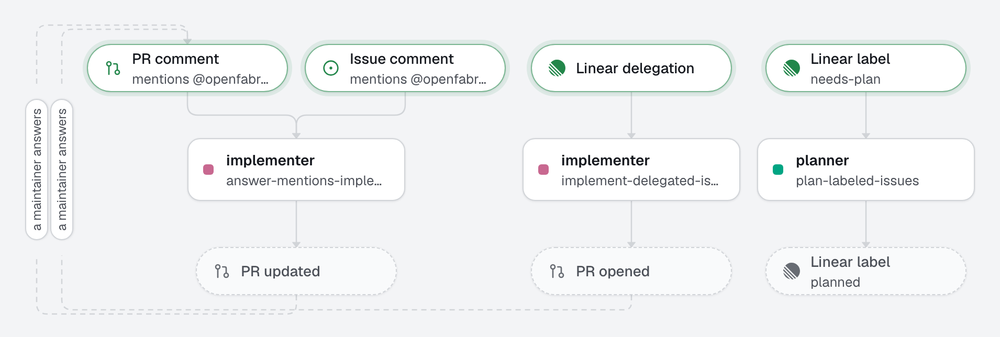

# 22: Linear delivery

The team plans and hands work over in Linear, and the code lands on GitHub. A label asks the factory for an implementation plan, written in the issue. Assigning the issue to openfabriq, like a teammate, hands it over: an agent works in a fresh checkout, shows its progress in the issue's agent session, and answers there with the link of the pull request. A human reviews and merges on GitHub, and Linear moves the issue to *Done*.

Linear reaches openfabriq through your relay, a Cloudflare Worker you deploy once with `openfabriq connect relay` (a free account is enough), or the same code on a server of yours. It keeps what comes in while your machine sleeps; the agents run on your machine.

## What this factory does



## Plan, then hand over

- **`needs-plan`** on an issue of the team starts the planner. It reads the code, and writes in the issue what changes, the steps, the tests, the risks and its questions, each with a proposed answer. It changes nothing, then swaps `needs-plan` for `planned`.
- **Assign the issue to openfabriq**, or mention it in a comment: the implementer follows the plan when the issue has one, works test first, and opens the pull request, titled with the issue's identifier (`ENG-14: …`). When the issue is unclear, it opens nothing and asks its questions in the session; answer there, and it goes on.
- **On GitHub**, the pull request lives like any other: a maintainer's `@openfabriq` on it gets an answer from the implementer.

Least privilege: a Linear run may comment, change the issue's labels, and open a pull request; it can neither push to an existing pull request nor review one. Before the pull request leaves, the engine runs the `checks` itself.

## Tree

```
openfabriq/
├── factory.yaml                          integrations.linear.team, setup, commands and checks
├── agents/
│   ├── planner/agent.md                  reads the issue and the code, writes the plan; reads only
│   └── implementer/agent.md              delivers the issue as a pull request, or asks
├── automations/
│   ├── plan-labeled-issues/              when: linear.issue.labeled needs-plan
│   └── implement-delegated-issues/       when: linear.issue.delegated
└── skills/
    └── test-driven-development/SKILL.md  test first, red then green, the failing run as proof
```

## Make it yours

1. Copy the `openfabriq/` folder to the root of your repository.
2. In `factory.yaml`, replace `repository`, `maintainers`, the Linear team's key, `setup` and the commands.
3. In Linear, create the `needs-plan` and `planned` labels in the team.
4. `openfabriq connect relay` once, then `openfabriq connect linear`: it explains how to create the Linear application and install it. Turn on Linear's GitHub integration for the repository, so the pull requests show on their issues.
5. Run `openfabriq plan`, then `openfabriq start`. Add `needs-plan` to an issue, or assign one to openfabriq.
