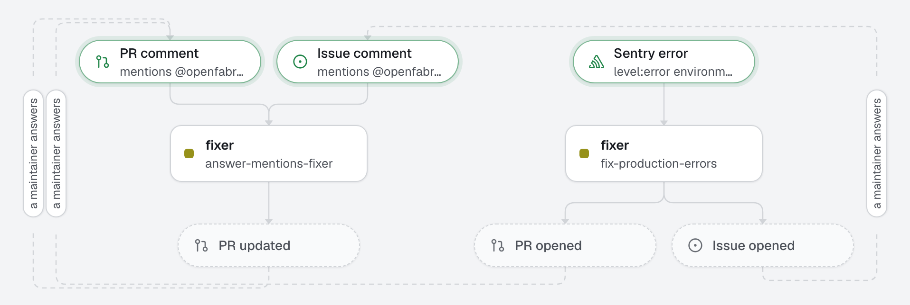

# 23: Sentry autofix

A new error in production becomes a pull request that fixes it, with a regression test that failed before the fix and passes after. When the fix is not small, the factory opens an issue that explains the cause instead; when the error is noise, it adds a note on the Sentry issue and stops. A human reviews and merges.

The concept: the harness (`setup`, `commands`, `checks`) around an agent that writes code, and an MCP server that lets the agent read more from Sentry than the engine hands it, with only the tools it lists.

## What this factory does



Your relay searches Sentry every minute and keeps new issues for the engine (no Sentry webhook to set up). The fixer gets the issue and the stack trace of its latest event; when that is not enough, it calls the Sentry MCP server for other events, tags and breadcrumbs. Before the pull request leaves, the engine runs `checks` itself: a failing check goes back to the agent, twice at most; if it still fails, no pull request is opened.

## Tree

```
openfabriq/
├── factory.yaml                       integrations.sentry, setup, commands, checks, mcp.sentry and its secret
├── agents/
│   └── fixer/agent.md                 tools: read, edit, shell; mcp: sentry get_issue_details, search_issues
├── automations/
│   └── fix-production-errors/         when: sentry.issue.created level:error environment:production
└── skills/
    └── browser-evidence/SKILL.md      check a visible fix with agent-browser, screenshots as proof
```

## Least privilege

- `can: [create_pull_request, create_issue, add_comment]`. From Sentry, `add_comment` is a note on the Sentry issue. `validate` refuses labels, pushes and reviews for a run that only comes from Sentry.
- The fixer lists two read-only tools of the Sentry MCP server. Every other tool of the server, like `update_issue`, is refused, and `openfabriq plan` shows each tool added to an agent as a security change. A listed tool that the server does not offer is noted in the run's details; the run goes on without it.
- The gate is the Sentry project: any error that reaches it can start a run, and error messages are written by whoever triggers the error. The agent treats them as data, the checks run, and a human merges.
- Stack traces can carry personal data. The engine leaves out frame variables; the fixer is told to use made-up values in tests and never copy personal data.

## The Sentry token of the MCP server

`MCP_SENTRY_TOKEN` is a name in `factory.yaml`; its value is read from the environment of `openfabriq start`, and sent as `Authorization: Bearer` to `https://mcp.sentry.dev/mcp`. It never reaches the agent's environment. Start the engine with it:

```sh
MCP_SENTRY_TOKEN=sntryu_... openfabriq start
```

Use a token of its own, read only (`org:read`, `project:read`, `event:read`). Declared in the server only, it goes to that server: not to the agent's environment, not to `setup` or the `commands` (it does show in the agent process's command line, like every MCP server's settings). `openfabriq start` names the secrets it does not find.

Not verified yet: the hosted Sentry MCP server offers OAuth, which openfabriq does not support in v1; whether it accepts a token as a bearer is still to check on a real run. If it does not connect, the run's details say so and the fixer works from the stack trace alone. The Sentry MCP server can also run on the machine, with `command:` instead of `url:`; see its README for the variable that carries the token (a `SENTRY_*` name cannot be a factory secret: map it in the command, like `SENTRY_ACCESS_TOKEN="$MCP_SENTRY_TOKEN" npx -y @sentry/mcp-server`).

## Make it yours

1. Copy the `openfabriq/` folder to the root of your repository.
2. In `factory.yaml`, replace `repository`, `maintainers`, the Sentry `organization` and `project` (add `url` for a self-hosted Sentry), `setup` and the `commands`. Adjust the `query` in the automation: it is Sentry's own search, `times_seen:>50` works too.
3. Run `openfabriq connect relay` once (your relay looks for new Sentry issues every minute), then `openfabriq connect sentry`: it asks for an auth token with `project:read`, `event:read` and `event:write` (for the notes), tests it, gives it to the relay and keeps it in `~/.openfabriq/secrets.json`. This is the engine's token, not `MCP_SENTRY_TOKEN`.
4. Create the read-only `MCP_SENTRY_TOKEN`; after `apply`, give it on the engine's machine with `openfabriq secret set MCP_SENTRY_TOKEN`.
5. For proof in a browser, install agent-browser on the engine's machine: `openfabriq doctor` prints the command, from the skill's `compatibility` (the engine's Docker image has it), and say in `skills/browser-evidence/SKILL.md` how your app starts.
6. Run `openfabriq plan`: it lists the MCP server, its two tools, the commands and the secret as security changes.
7. `openfabriq apply`, then `openfabriq start`.
