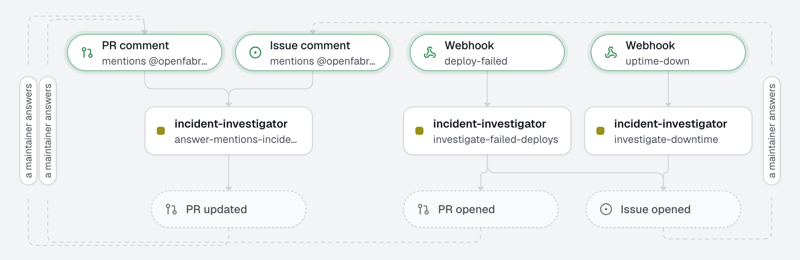

# 24: Deploy failure webhook

When a deploy fails or the site goes down, another service tells your relay, and the factory opens an incident issue: what failed, the commits that may have caused it, and what to do next. When one commit clearly broke the deploy, it also opens a pull request that reverts it. A human decides and merges.

The concept: `webhooks` and `webhook.received`. Any service that can send an HTTP request can start the factory, through your relay, which checks who sent it.

## What this factory does



The relay answers the sender at once and keeps the request until `openfabriq start` takes it, even while the machine sleeps. The agent receives the body as JSON, marked as data, cut beyond 50 000 characters; the headers are not passed. A webhook has nowhere to reply, so only `create_issue` and `create_pull_request` make sense; the engine ends their body with "Started by the webhook `<name>`". When a run opens both, the incident issue comes first and the revert pull request names it, so each links to the other.

## Tree

```
openfabriq/
├── factory.yaml                       webhooks (deploy-failed: standard, uptime-down: none), setup, commands, checks
├── agents/
│   └── incident-investigator/agent.md reads the payload and git history, writes the incident, may revert
└── automations/
    ├── investigate-failed-deploys/    when: webhook.received deploy-failed; can: create_issue, create_pull_request
    └── investigate-downtime/          when: webhook.received uptime-down; can: create_issue
```

## Who can start it

`maintainers` do not apply: the signature is the gate. Each `signature` word is a way for the sender to prove it is who it says:

| `signature` | The sender proves it by… | Secret |
| --- | --- | --- |
| `github` | `X-Hub-Signature-256`, HMAC-SHA256 of the body | generated by `connect webhook` |
| `sentry` | `Sentry-Hook-Signature`, HMAC-SHA256 of the body | the integration's Client Secret, pasted in `connect webhook` |
| `stripe` | `Stripe-Signature`, HMAC-SHA256 of the timestamp and the body | Stripe's signing secret (`whsec_…`), pasted in `connect webhook` |
| `standard` | the Standard Webhooks specification (`webhook-id`, `webhook-timestamp`, `webhook-signature`) | generated by `connect webhook` (`whsec_…`) |
| `none` | nothing: the secret is the last part of the address | generated by `connect webhook` |

The relay refuses an unknown webhook or a bad signature (`401`), a timestamp more than 5 minutes off for `stripe` and `standard`, and a body over 1 MB. A delivery it has already seen in the last 7 days (same `webhook-id`, or the same body when the sender gives no id) does not start a second run.

`none` is the weakest: anyone who sees the address can start a run. That is why `uptime-down` may only open an issue, never a pull request. Use `none` only for a sender that cannot sign, and keep its address private.

A stolen secret lets someone forge alerts: the cost stays within `usd_per_day`, and the outputs within `can`. The agent cannot see existing issues, so two alerts for the same incident open two issues; `concurrency: repository` runs them one after the other.

## Make it yours

1. Copy the `openfabriq/` folder to the root of your repository.
2. In `factory.yaml`, replace `repository`, `maintainers`, `setup` and the `commands`. Rename the webhooks if you like; set each `signature` to what its sender supports. A webhook name must be unique on the engine's machine.
3. Set up the relay, once per machine: `openfabriq connect relay`. It deploys it to your Cloudflare account (a free one is enough), or checks one you run yourself (`--url`).
4. Run `openfabriq plan` and `openfabriq apply`: `connect webhook` reads the applied factory.
5. Run `openfabriq connect webhook deploy-failed`. It gives the relay a new secret and prints the URL and the secret, once. Paste both in your deploy platform's webhook settings (any sender that supports Standard Webhooks), for failed deploys only. To try it before your platform sends one, sign a request yourself, with the URL and the secret it printed:
   ```sh
   URL='<the URL>'; SECRET='<the secret>'
   id=msg_$(date +%s); ts=$(date +%s); body='{"status":"failed","environment":"production"}'
   key=$(printf '%s' "${SECRET#whsec_}" | base64 -d | od -An -tx1 | tr -d ' \n')
   sig=$(printf '%s' "$id.$ts.$body" | openssl dgst -sha256 -mac HMAC -macopt "hexkey:$key" -binary | base64)
   curl -X POST "$URL" -H 'Content-Type: application/json' -H "webhook-id: $id" -H "webhook-timestamp: $ts" -H "webhook-signature: v1,$sig" -d "$body"
   ```
6. Run `openfabriq connect webhook uptime-down`. It prints one address with the secret in it: paste it in your uptime monitor's webhook settings. To try it:
   ```sh
   curl -X POST '<the address>' -H 'Content-Type: application/json' -d '{"status":"down","url":"https://example.com","since":"2026-11-03T09:12:00Z"}'
   ```
7. `openfabriq start`. To change a secret, run `connect webhook <name>` again; to stop accepting a webhook, `openfabriq connect webhook <name> --remove`. Removing it from `factory.yaml` is not enough: the relay accepts it until then, and `plan` reminds you.
