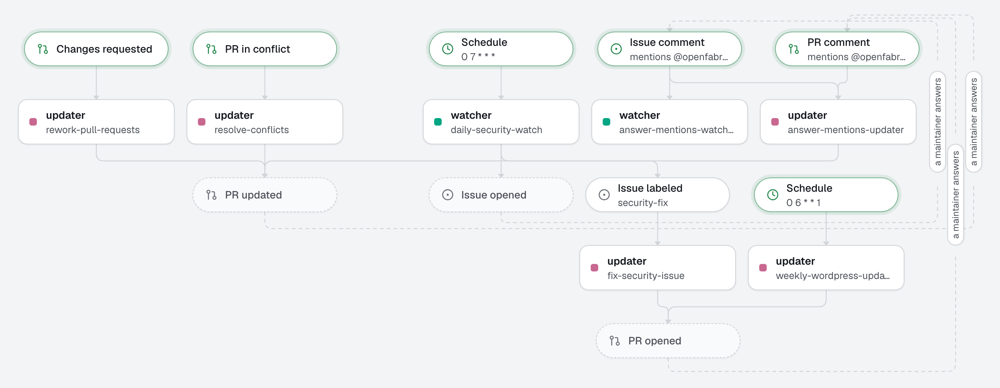

# 25: WordPress maintenance

A factory that keeps a WordPress site up to date and safe, for a site whose core, plugins and themes are Composer packages (a [Bedrock](https://roots.io/bedrock/)-style repository, with [wpackagist](https://wpackagist.org)). Every Monday, one pull request brings everything up to date and explains each bump. Every morning, a watcher checks the installed plugins and themes against [WPScan](https://wpscan.com)'s vulnerability database; each new vulnerability becomes an issue, and that issue gets its fix as a pull request within minutes. A human merges; the site's own deploy ships it.

This one keeps a WordPress site alive; [26-webflow-to-astro](../26-webflow-to-astro) and [27-framer-to-astro](../27-framer-to-astro) move a site to Astro.

## What this factory does



- **Every Monday at 06:00**, the updater opens one pull request that brings the core, the plugins and the themes up to date, and explains each bump. Known vulnerabilities are fixed on the way; major versions are left for a human.
- **Every morning at 07:00**, the watcher checks the installed plugins and themes against WPScan. Each new vulnerability that hits an installed version becomes one issue, labeled `security-fix`. When nothing is new, it writes nothing.
- **The `security-fix` label** starts the updater on that issue. When a version fixes the vulnerability, it opens a pull request `fix(security): …` that closes the issue. When none does yet, it comments what is affected, the workaround, and what a person has to decide.

Inside a run: `vulns` runs [`scripts/wpscan-report.sh`](openfabriq/scripts/wpscan-report.sh), which asks WPScan about every plugin and theme of `composer.lock`, `outdated` lists what is behind, the agent reads the changelogs, edits `composer.json` and runs `update`. Before a pull request leaves the machine, the engine runs the `checks` itself (`syntax`, `lint`, `analyse`) and refuses it if one fails.

## Notes

- **Only a site in git, managed with Composer.** openfabriq works on the repository, never on the live site. A site updated by hand in wp-admin, or with plugins committed as files, does not fit: move it to Composer first.
- **`secrets: [WPSCAN_API_TOKEN]`**: the commands receive it, and the `vulns` script reads it; never an agent. Get a token on wpscan.com, then `openfabriq secret set WPSCAN_API_TOKEN`. The free plan has a small daily quota of requests, one per plugin or theme: check yours against the size of the site.
- **The watcher reports only what is new** (published in the last 26 hours). It cannot see GitHub, so it does not know what it reported before; the weekly update fixes the older vulnerabilities.
- **`create_issue: [security-fix]`**: the engine puts the label on every issue the watcher opens, which starts the fix. Nothing else starts it, so a person can also label an issue `security-fix` by hand.
- **`concurrency: repository`** on every automation: one run at a time, so a fix and the weekly update never race on `composer.lock`.
- **No database in the checks.** The commands' sandbox lets out only HTTP and HTTPS, so a check cannot reach MySQL: WordPress integration tests and WP-CLI against a database do not run here. The checks are static: PHP syntax, the WordPress Coding Standards (`phpcs`), and PHPStan. Test what changed on a staging site before you merge a `high` risk bump.
- **The script comes from the applied factory.** `vulns: scripts/wpscan-report.sh` runs `openfabriq/scripts/wpscan-report.sh` as `apply` copied it, never the file of a pull request's branch: changing it goes through `plan`, which shows it as a security change. Its test runs it on a fake `composer.lock` against a fake WPScan, with no token and no quota: `node --test 'openfabriq/scripts/test/*-test.mjs'` (it needs `php`).
- **The agents never deploy.** `can` has no merge: the pull request waits for a human, and your CI deploys what is merged.

## Tree

```
openfabriq/
├── factory.yaml                       timezone, setup (composer install), commands (outdated, update, vulns, syntax, lint, analyse), checks, secrets
├── scripts/
│   ├── wpscan-report.sh               the vulns command: composer.lock → WPScan → wpscan-report.json
│   └── test/                          its test, with a fake composer.lock and a fake WPScan
├── agents/
│   ├── updater/agent.md               bumps through Composer, a table per package, security first, majors for a human
│   └── watcher/agent.md               new vulnerabilities only, one issue per package, no exploit copied
└── automations/
    ├── weekly-wordpress-updates/      when: schedule "0 6 * * 1"; can: create_pull_request
    ├── daily-security-watch/          when: schedule "0 7 * * *"; can: create_issue [security-fix]
    ├── fix-security-issue/            when: issue.labeled security-fix; can: create_pull_request, add_comment
    ├── rework-pull-requests/          when: pull_request.changes_requested
    └── resolve-conflicts/             when: pull_request.conflicted (composer.lock regenerated, never edited)
```

## Make it yours

1. Copy the `openfabriq/` folder to the root of your repository.
2. In `factory.yaml`, replace `repository`, `maintainers` and `timezone`. Adapt the paths of `syntax` to where your own code lives (`web/app/themes` and `web/app/mu-plugins` in Bedrock), and `lint` and `analyse` to your tools: they expect a `phpcs.xml` with the WordPress standard and a `phpstan.neon` (with `szepeviktor/phpstan-wordpress`, for example).
3. Run `openfabriq doctor`: it checks that the engine's machine has `composer`. The `vulns` script and the `syntax` check also run `php`, which `doctor` cannot see behind them.
4. Run `openfabriq plan`: it lists the commands, the script, the checks and the secret as security changes, since they run on your machine.
5. `openfabriq apply`, then `openfabriq secret set WPSCAN_API_TOKEN` (it takes only a name of an applied factory), then `openfabriq start`.
6. To try it now: `openfabriq run daily-security-watch`, or `openfabriq run weekly-wordpress-updates`.
